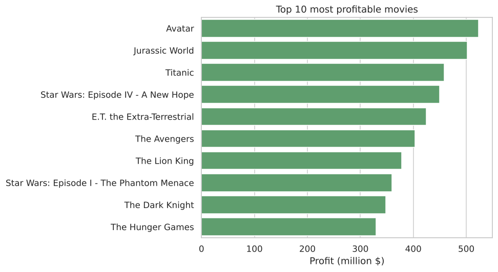
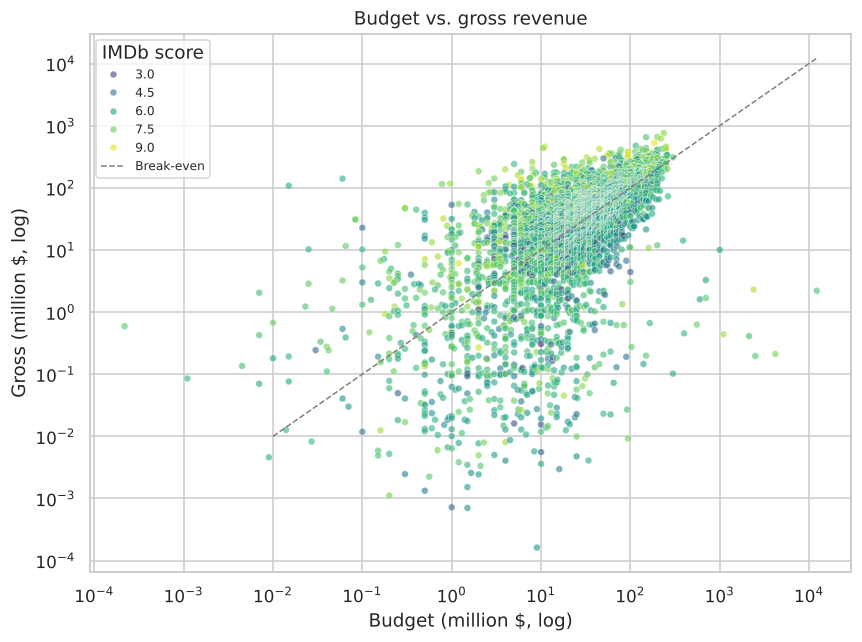
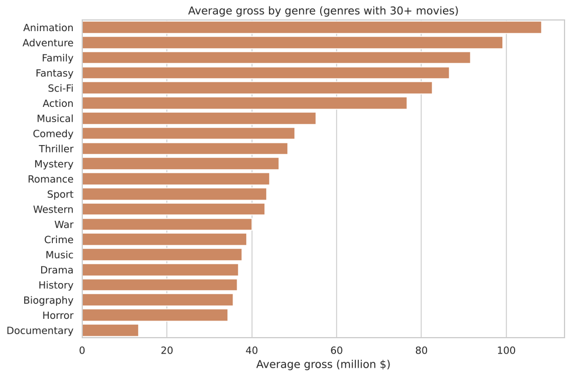
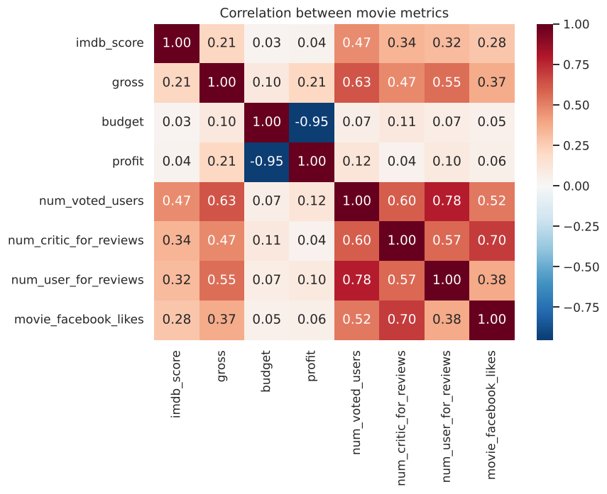

<<<<<<< HEAD
# Movie Trend Analysis — IMDb 5000 Dataset

Exploratory data analysis (EDA) of ~5,000 movies from the Kaggle IMDb 5000 dataset, using **Python, Pandas, Matplotlib and Seaborn**. The project cleans the raw data, then explores profitability, IMDb ratings, genre popularity, directors and audience engagement to find trends in the film industry.

📓 **[View the notebook](movie_analysis.ipynb)** · 📄 **[PDF report](reports/movie_analysis.pdf)**

---

## Dataset

| | |
|---|---|
| Source | [IMDb 5000 Movie Dataset (Kaggle)](https://www.kaggle.com/datasets/carolzhangdc/imdb-5000-movie-dataset) |
| Raw size | 5,043 movies × 28 columns (`data/Movie_Data.csv`) |
| Cleaned size | 3,856 movies × 18 columns (`data/movies_cleaned.csv`) |
| Years covered | 1916 – 2016 |

Key fields: title, director, lead actor, genres, budget, gross, IMDb score, user votes, critic and user review counts, language and Facebook likes.

## Tools

Python 3 · Pandas · NumPy · Matplotlib · Seaborn · Jupyter Notebook

## Project Structure

```
movie-trend-analysis/
├── data/
│   ├── Movie_Data.csv          # raw dataset
│   └── movies_cleaned.csv      # cleaned + enriched output (profit, ROI, genre_1/2, decade)
├── images/                     # charts exported by the notebook
├── reports/
│   ├── movie_analysis.pdf      # full notebook with outputs
│   └── movie_analysis.html
├── movie_analysis.ipynb        # main analysis notebook
├── requirements.txt
└── README.md
```

## Approach

1. **Inspection:** shape, data types, summary statistics.
2. **Cleaning:**
   - Profiled missing values. `gross` (17.5%) and `budget` (9.8%) were the only columns above a 5% threshold.
   - Dropped 15 columns not needed for the analysis.
   - Removed rows missing `budget` or `gross`, plus rows with more than 5 nulls.
   - Filled missing `language` values with "English".
   - Stripped hidden non-breaking spaces from titles.
   - Removed 35 duplicate rows. About 77% of the rows are retained.
3. **Feature engineering:** converted budget and gross to million $. Added `profit`, `roi`, `decade`, `genre_1` and `genre_2`.
4. **Analysis:**
   - Top 10 most profitable films
   - IMDb Top 250 (more than 25k votes) and top foreign-language films
   - Best directors, both raw and with a minimum of 5 films
   - Top genre combinations by average gross
   - Critic vs. audience favourite actors
   - Yearly trends and metric correlations

## Key Findings

- **Avatar is the most profitable film** (~$524M profit). James Cameron directs two of the top 10.
- **Engagement predicts quality better than spending.** IMDb score correlates at 0.47 with the number of user votes but only 0.03 with budget.
- **Animation, Adventure and Family earn the most per film.** Drama, Comedy and Thriller are the most common genres. **Family + Sci-Fi** is the highest-grossing genre pair on average.
- **Christopher Nolan and Quentin Tarantino** have the highest average ratings among directors with 5+ films.
- **Leonardo DiCaprio** draws the most critic and user reviews per film, compared with Brad Pitt and Meryl Streep.
- **37 foreign-language films** appear in the IMDb Top 250, including Veer-Zaara and My Name Is Khan.

| | |
|---|---|
|  |  |
|  |  |

## Data Quality Note

Some non-English films report `budget` in local currency (for example, *The Host* shows a 12,215M "budget" in Korean won), while `gross` is in USD. These rows are kept so results stay comparable with the original assignment, and the issue is flagged in the notebook.

## How to Run

```bash
git clone https://github.com/<your-username>/movie-trend-analysis.git
cd movie-trend-analysis
pip install -r requirements.txt
jupyter notebook movie_analysis.ipynb
```

Run all cells (**Kernel → Restart & Run All**). Charts are saved to `images/` and the cleaned data to `data/movies_cleaned.csv`.
=======
# Movie-Trend-Analysis
>>>>>>> 587e35a83c5659e3fc27e935de905ce06e0c83e2
